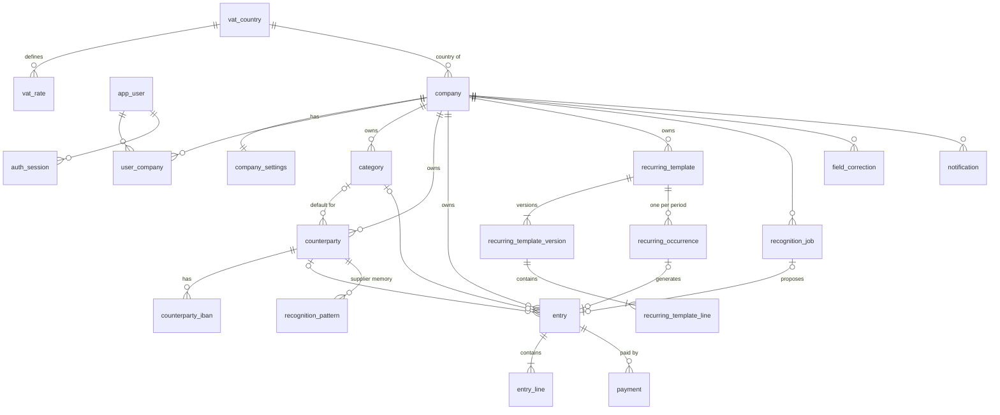

# Ficka — Database schema

The executable reference is [`schema.sql`](schema.sql). This page explains the model, the rules that live in the service layer, and the seed data.

SQLite is the database. The real tables are created by SQLModel + Alembic migrations, which must stay equivalent to `schema.sql`.

## Conventions

| Kind | Storage | Example |
|---|---|---|
| Money | `INTEGER` cents | 1 512,50 € → `151250` |
| VAT rate | `INTEGER` basis points, `NULL` = no VAT | 21 % → `2100` |
| Date | `TEXT` `YYYY-MM-DD` | `2026-11-14` |
| Timestamp | `TEXT` ISO-8601 UTC | `2026-11-21T16:40:00Z` |
| Boolean | `INTEGER` 0 / 1 | |
| VAT number, IBAN | normalized: no spaces or dots, upper case | `BE0123456749` |
| Structured reference | 12 digits, formatted only on display | `090933755493` → `+++090/9337/55493+++` |

Every business table carries `company_id`. v1 runs with one company and one user. The link exists so that adding more later is a UI change, not a migration.

`PRAGMA foreign_keys = ON` must be set on every connection.

## Overview



## Tables by area

### 1. Company, users, settings

- **`company`**: name, country (`BE`), VAT number, currency.
- **`company_settings`**: one row per company.
  - `recurring_generation_timing`: `first_of_month` or `due_date`
  - `recurring_validation_mode`: `review` or `automatic`
  - `amounts_include_vat_default`: the starting position of the toggle on the entry form
  - `starting_balance_cents` and `starting_balance_date`: both set or both empty
  - `document_ttl_hours`: how long an abandoned upload is kept (default 24)
  - `locale`
- **`app_user`**, **`user_company`**, **`auth_session`**: a single local account. Passwords are hashed with argon2id. Sessions store a hash of the token, never the token itself. The only role is `owner`.

### 2. VAT configuration

- **`vat_country`** and **`vat_rate`**: rates are data with `valid_from` / `valid_to`. A summary for an old quarter uses the rates valid back then.
- Belgium is seeded with 21 / 12 / 6 / 0 %.

### 3. Categories and counterparties

- **`category`**:
  - Each one has a direction (income or expense) and a default VAT rate (`NULL` = no VAT).
  - `is_seeded` marks the ones created at install. All of them are editable, and the user can add custom ones.
  - Deleting a category that is still used is **blocked** (`ON DELETE RESTRICT`). The UI asks the user to reassign its entries first.
- **`counterparty`**:
  - A customer, a supplier or both, with an optional default category and default VAT rate.
  - The VAT number is unique per company.
  - This is the anchor for supplier memory.
- **`counterparty_iban`**: a counterparty can have several IBANs. They are indexed for matching documents (and, later, bank statements).

### 4. Ledger

**`entry`**: one income or expense.

| Column | Role |
|---|---|
| `status` | `proposed` or `confirmed`: does it count? |
| `source` | `manual`, `recurring`, `document`, `bank`: where it came from. Set once, never changes. |
| `invoice_date`, `due_date` | VAT period and cash forecast. The due date can't be before the invoice date. |
| `counterparty_id`, `category_id` | Optional on proposals; the UI warns when they're missing. |
| `invoice_number`, `structured_reference` | Used for duplicate detection and payment matching. |
| `amounts_include_vat` | The input mode the user used, remembered for editing. |
| `total_*_cents` | **Cached** totals, always recomputed from the lines by the service. The database checks that gross = net + VAT. |
| `document_hash` | SHA-256 of the processed file, for duplicate detection. |
| `document_location` | An optional link to where the original lives (another platform). |
| `confirmed_at` | Set if and only if the status is `confirmed` (enforced by a check). |

**`entry_line`**:
- A net amount, a VAT rate (`NULL` = no VAT), and a VAT amount.
- `vat_manual = 1` means the user (or the document) set the VAT amount, so Ficka stops recalculating it.
- A line without a rate must have 0 VAT (enforced).

**`payment`**:
- Each payment has a date, a positive amount, and a source: `manual`, `assumed` or `bank`.
- Payment status is **never stored**. It's derived from the payments (next section).

### 5. Recurring

- **`recurring_template`**:
  - `interval_months` sets the frequency: 1 = monthly, 3 = quarterly, 12 = yearly.
  - `due_day` runs from 1 to 31. 31 means the last day of the month (also for February).
  - Optional end date or `max_occurrences`. `amount_mode` is `fixed` or `variable`.
- **`recurring_template_version`** and **`recurring_template_line`**: a price change creates a new version with an `effective_from` date. Past occurrences keep the version they were generated from.
- **`recurring_occurrence`**:
  - One row per `(template, period)`. The unique constraint is the **idempotency guard**: running the generator twice cannot create duplicates.
  - Statuses: `pending → generated` or `skipped`. A `generated` occurrence must point to an entry.
  - **Trigger `trg_entry_delete_skips_occurrence`**: deleting a generated entry sets its occurrence to `skipped`, so it's never regenerated.

### 6. Recognition

No document content is stored. The file lives in a temporary folder, never in the database.

- **`recognition_job`**:
  - The UUID id doubles as the temporary file name.
  - Statuses: `queued → processing → ready → resolved`, or `failed` / `expired`.
  - `result_json` holds the extracted fields (value, confidence, source, bounding box) **only while the job is open**.
  - A check guarantees that `resolved` and `expired` jobs keep neither `temp_path` nor `result_json`. What remains is a small statistics row: detected type, extractor, overall confidence, duration.
- **`recognition_pattern`**:
  - The supplier memory: for one counterparty and one field, how to find the value. It's a label (`Factuurnummer`), a regex or a normalized zone on the page.
  - `hits` and `misses` rank the patterns.
- **`field_correction`**:
  - What the user changed between the proposal and confirmation, with the proposed confidence and the field's source.
  - It feeds the memory and the accuracy and calibration statistics.

### 7. Notifications and app state

- **`notification`**: only events worth telling the user once (toasts, a short history). Badges such as "5 proposals" or "2 overdue" are **computed live** from the data, never stored.
- **`app_state`**: a key/value table for the background jobs, for example `recurring.last_run_at` for the startup catch-up and `cleanup.last_run_at`.

## Status reference

| Status | Values | Stored? | Role |
|---|---|---|---|
| Entry status | `proposed`, `confirmed` | yes | Does it count in results and VAT? A rejected proposal is deleted. |
| Entry source | `manual`, `recurring`, `document`, `bank` | yes | Where it came from (icon, filters, stats) |
| Payment status | `unpaid`, `partial`, `paid`, `overdue` | **no**, derived | Has the money moved? |
| Occurrence | `pending`, `generated`, `skipped` | yes | Idempotent recurring generation |
| Recognition job | `queued`, `processing`, `ready`, `failed`, `expired`, `resolved` | yes | Drives the companion chip |

**Where each entry status counts**

| | Results and charts | VAT summary | Cash forecast | Badges and attention card |
|---|---|---|---|---|
| `proposed` | no | no (shown as a warning) | yes, "expected" | yes |
| `confirmed` | yes | yes | yes | only if overdue |

**Payment status derivation**

```text
paid_total = SUM(payment.amount_cents)
if paid_total >= total_gross_cents   -> paid
elif paid_total > 0                  -> partial  (overdue if due_date < today)
elif due_date < today                -> overdue
else                                 -> unpaid
```

## Rules enforced by the service layer

The database guards integrity. The service layer owns the business logic:

1. **Totals.** After any change to an entry's lines, recompute `total_net`, `total_vat` and `total_gross` in the same transaction.
2. **VAT calculation.**
   - When `vat_manual = 0`: `vat = round_half_up(net × rate_bp / 10000)`.
   - In "amounts include VAT" mode: `net = round_half_up(gross × 10000 / (10000 + rate_bp))`, then `vat = gross − net`, so the gross the user typed is kept exactly.
   - When the user or the document sets the VAT, `vat_manual = 1`. "↺ Recalculate" sets it back to 0.
3. **Rate validity.** A line's rate must exist in `vat_rate` for the company's country on the entry's `invoice_date` (or be `NULL`).
4. **Recurring generation.**
   - Look for missing occurrences for each active template, using the timing setting: everything due this month on the 1st, or each one on its due date. Also catch up on startup.
   - Insert the occurrence and the entry in one transaction. On a unique-constraint conflict, the occurrence already exists: skip it.
   - In `automatic` mode with a `fixed` amount: create the entry as `confirmed` and add a payment with source `assumed` on the due date. A `variable` template is **always** `proposed`.
5. **Duplicates.** When a document is uploaded, warn if `document_hash` matches an existing entry, or if `(counterparty, invoice_number)` already exists.
6. **Document cleanup.**
   - On confirm or reject: delete the file, clear `temp_path` and `result_json`, and set the job to `resolved`.
   - A periodic job (also run at startup) expires jobs past `expires_at` the same way.
7. **Starting balance.** Estimated balance = `starting_balance_cents` + income payments − expense payments made on or after `starting_balance_date`.

## Example: quarterly VAT summary

```sql
SELECT e.direction,
       l.vat_rate_bp,
       SUM(l.net_cents) AS net_cents,
       SUM(l.vat_cents) AS vat_cents
FROM entry e
JOIN entry_line l ON l.entry_id = e.id
WHERE e.company_id = :company_id
  AND e.status = 'confirmed'
  AND e.invoice_date BETWEEN :quarter_start AND :quarter_end
GROUP BY e.direction, l.vat_rate_bp;
-- balance = VAT on income − VAT on expenses  (> 0: to pay, < 0: to recover)
```

## Seed: default categories

These are created for each new company with `is_seeded = 1`. All are editable starting values. Default VAT rates are only suggestions on the entry form.

| Direction | Category | Default VAT |
|---|---|---|
| income | Services | 21 % |
| income | Goods | 21 % |
| income | Other income | no VAT |
| expense | Rent & premises | no VAT |
| expense | Energy & utilities | 21 % |
| expense | Telecom & internet | 21 % |
| expense | Software & subscriptions | 21 % |
| expense | Office supplies | 21 % |
| expense | Equipment | 21 % |
| expense | Vehicle & fuel | 21 % |
| expense | Travel | 21 % |
| expense | Restaurants & reception | 12 % |
| expense | Insurance | no VAT |
| expense | Professional fees | 21 % |
| expense | Bank fees | no VAT |
| expense | Salaries & social charges | no VAT |
| expense | Taxes & contributions | no VAT |
| expense | Marketing | 21 % |
| expense | Training | 21 % |
| expense | Other | 21 % |
